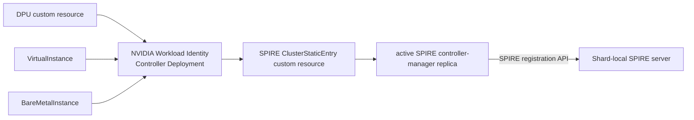

# NVIDIA Workload Identity Controller

`dsx-identity-controller` watches DPU, Launch Layer `VirtualInstance`, and
Launch Layer `BareMetalInstance` objects in one management cluster. It derives
the corresponding [SPIRE](https://spiffe.io/docs/latest/spire-about/) `ClusterStaticEntry` objects without modifying its
sources.

The Identity Controller owns non-Pod registration fields. The official SPIRE
controller-manager owns Pod registrations. The controller rejects duplicate
child SPIFFE IDs and duplicate VM Pod UIDs, removes stale entries for invalid
sources, and reconciles again when the source or conflicting entry changes.

Every DPU source identifies its paired operator-owned BM through the
`carbide.nvidia.com/dpu-machine-id` label. A complete tenant
`BareMetalInstance` for that DPU replaces the operator fallback entry. The
`launchlayer.nvidia.com/org-id` annotation supplies the tenant. Both BM and VM
sources may supply `launchlayer.nvidia.com/role` to append `/role/<role>` to
their subjects. See the [identity contract](../../docs/identity-contract.md)
for role validation and exchange behavior.

A `VirtualInstance` supplies the VM instance ID, worker node name, and current
virt-launcher Pod UID. Its identity is parented to the operator-owned worker's
`dsx_imds` agent and selected only by that Pod UID.

The official controller-manager registers each Kubernetes Pod beneath its
worker's `dsx_imds`-attested agent. Its registration uses the configured
operator tenant, Kubernetes node name, and Pod UID, and the Kubernetes
WorkloadAttestor serves it. The paired BM registration is parented to the
external `dpu_hw`-attested agent identified by the DPU serial number.

The controller runs in the regular management cluster that owns the identity
shard's source CRs through
`charts/dsx-identity/templates/identity-controller.yaml`.

## Flags

| Flag | Default | Purpose |
| --- | --- | --- |
| `--trust-domain` | required | Local SPIRE trust domain |
| `--operator-tenant` | required | Configured tenant for operator identities |
| `--class-name` | required | SPIRE controller-manager class name |
| `--dpu-metadata-selector` | required, repeatable | Kubernetes WorkloadAttestor selector for DPU IMDS |
| `--source-api-poll-interval` | `1h` | Positive duration between discovery retries for absent source APIs |
| `--metrics-bind-address` | `:8080` | Controller metrics address |
| `--health-probe-bind-address` | `:8081` | `/healthz` and `/readyz` address |
| `--leader-elect` | `true` | Enable Kubernetes leader election |

The command uses the active Kubernetes client configuration and requires the
SPIRE CRDs. DPU and Launch Layer source watches start when their APIs exist.
The controller checks APIs at startup and retries absent APIs every hour by
default. Set `--source-api-poll-interval` to change the retry period. It
registers watches when the CRDs are installed. Existing source objects reconcile when the watch
starts. Without the `BareMetalInstance` API, DPU sources retain their
operator-owned BM identities. Its assignment watch replaces those identities
when complete tenant assignments appear. Discovery and access errors remain
errors.
