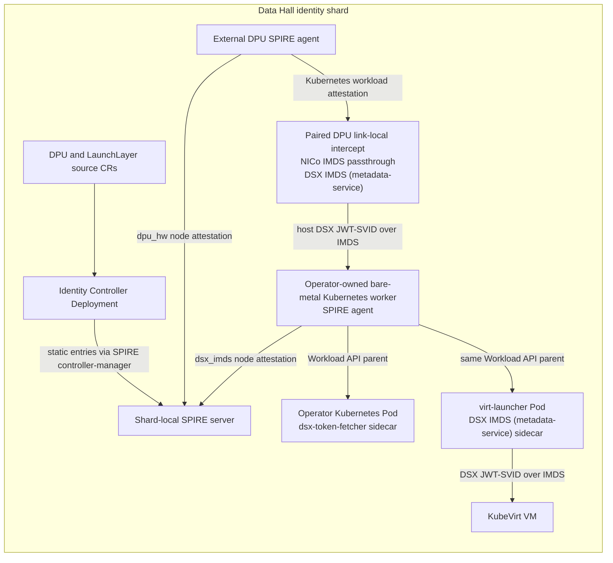
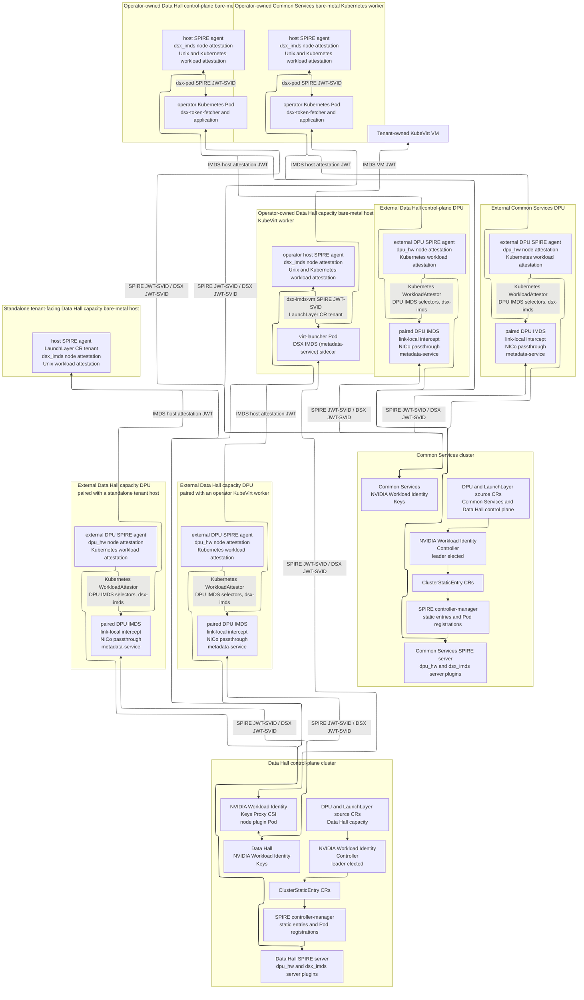
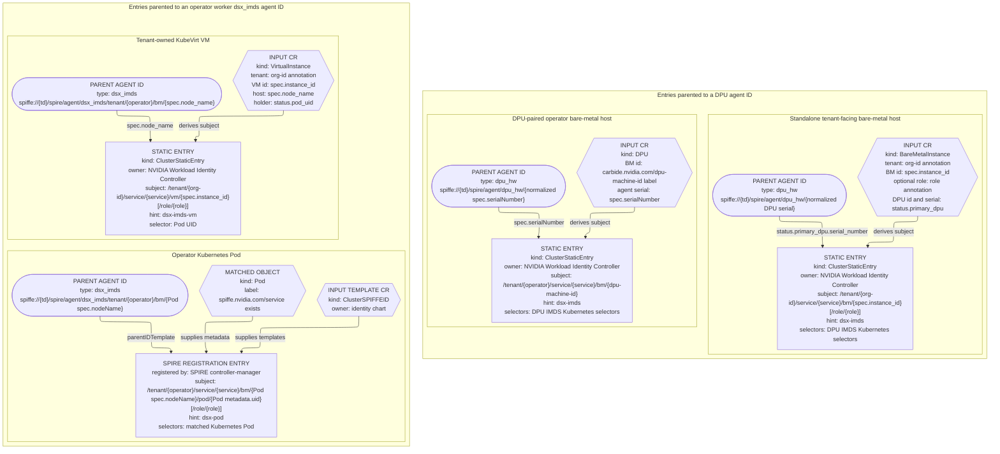
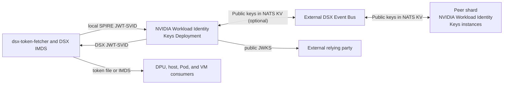

# Architecture

Hardware-backed workload identity starts at the operator-owned DPU, which runs
in zero trust mode. The DPU anchors attestation for its paired bare-metal host.
The attested host provides identities to its Pods and VMs. The `dpu_hw`
NodeAttestor identifies each DPU by its serial number. The bundled `dpu_hw`
server accepts the serial as plaintext attestation data.

[SPIRE](https://spiffe.io/docs/latest/spire-about/) runs a server that registers identities and agents that identify local
callers. Node attestation verifies an agent's attestation data before SPIRE
issues its identity credential, called an [SVID](https://spiffe.io/docs/latest/spiffe-about/spiffe-concepts/#spiffe-verifiable-identity-document-svid). Workload attestation matches
caller properties to registration entries before an agent serves a workload
SVID. A registration's parent agent determines which agent can serve that identity.

An identity shard contains independent SPIRE and Identity Keys deployments.

Common Services owns the identity shard for Common Services and Data Hall
control-plane resources. Each Data Hall owns the shard for its capacity
resources. Both shards derive entries from their local DPU and LaunchLayer
source CRs, and their Pods register beneath local `dsx_imds` agents.

SPIRE registration parentage follows the attested agent. Resource subjects and
tenant claims identify ownership. DPUs run as Kubernetes workers in their Kamaji
clusters.

Every host-cluster Kubernetes worker is an operator-owned bare-metal host.
Pods on these workers use the configured operator tenant and a `/bm/<node-name>/pod/<pod-uid>`
subject. A tenant-facing bare-metal host is standalone and never becomes a
Kubernetes node. A KubeVirt VM runs in an operator-owned virt-launcher Pod, so
the Pod keeps its operator identity while its metadata sidecar selects the
dynamically tenant-supplied VM SVID from the same operator host Workload API.

## Registration parentage

The NVIDIA Workload Identity Controller owns DPU-derived, standalone host, and
VM `ClusterStaticEntry` CRs. The SPIRE controller-manager registers those
entries and registers Pods directly from the chart-owned `ClusterSPIFFEID`
template.

Hexagons show inputs, stadiums show attested parent agent IDs, and rectangles
show static CRs or Pod registration entries. `{service}` comes from
`global.dsx.defaultServiceName` for static CRs and the
`spiffe.nvidia.com/service` label for Pods.

The DPU resource supplies the worker-to-DPU relationship. Its IMDS registration
allows DPU-hosted DSX IMDS to obtain the paired worker's SPIRE JWT-SVID and
exchange it for the DSX JWT-SVID returned through link-local IMDS. The worker uses
that DSX JWT-SVID to attest its local SPIRE agent through `dsx_imds`.

For a tenant-assigned host, the `BareMetalInstance` supplies the host-to-DPU
relationship. Its entry replaces the operator fallback derived from the DPU
resource.

Local consumers exchange local SPIRE JWT-SVIDs with their shard's NVIDIA
Workload Identity Keys for DSX JWT-SVIDs. NVIDIA Workload Identity Keys instances
share only public signing keys across shards.

A SPIRE JWT-SVID is a cluster-local credential obtained from the local SPIRE
Workload API. A DSX JWT-SVID is the credential returned by the local NVIDIA
Workload Identity Keys. SPIRE JWT-SVIDs never establish trust between shards.

Install the identity chart once per shard. Each regular management cluster
that owns DPU or LaunchLayer source CRs runs the Identity Controller for its
shard. Every NVIDIA Workload Identity Keys instance validates only local SPIRE
JWT-SVIDs through its node-local Workload API. It serves aggregate public keys
received through the [Event Bus](https://docs.nvidia.com/dsx-exchange/architecture#dsx-event-bus) when [NATS](https://docs.nats.io/nats-concepts/jetstream/key-value-store) is enabled, or only local public keys
when NATS is disabled.

The Event Bus, OAuth2 provider, and relying parties are external to the
identity chart.

DPF registers DPU Agent and DPUService workload identities through the external
[DPF identity configuration](../charts/dsx-identity/README.md#dpf-identity-configuration).
The Identity Controller registers the paired host identity served by DPU IMDS.

## Identity delivery

| Consumer | SPIRE trust path | DSX JWT-SVID delivery |
|---|---|---|
| [Kubernetes Pod](../cmd/dsx-token-fetcher/README.md) | Kubernetes WorkloadAttestor under the worker's `dsx_imds`-attested host agent. The registration uses the operator tenant and worker host subject | The `dsx-token-fetcher` sidecar selects `dsx-pod`, exchanges the local SPIRE JWT-SVID, and writes the DSX JWT-SVID to a Pod-private volume mounted read-only in application containers |
| DPU service Pod | DPF exposes the DPU SPIRE agent through `csi.spiffe.io` | Native admission injects the standard token-fetcher sidecar and token volume |
| DPU IMDS | The external DPU agent attests through the `dpu_hw` NodeAttestor agent and server. Its Kubernetes WorkloadAttestor binds the paired BM identity to the IMDS Pod | [SPIFFE CSI](https://github.com/spiffe/spiffe-csi) exposes the DPU agent Workload API socket. DSX IMDS selects `dsx-imds`, exchanges the local SPIRE JWT-SVID, and serves the BM DSX JWT-SVID through IMDS |
| [Bare-metal host process](../cmd/dsx-imds-node-attestor-agent/README.md) | The DPU agent is attested through `dpu_hw`. The host agent is attested through the repository `dsx_imds` NodeAttestor agent and server, then can serve local processes through the Unix WorkloadAttestor | The paired DPU intercept carries link-local IMDS to [NICo](https://docs.nvidia.com/infra-controller/) IMDS, which passes identity requests to DSX IMDS. DPU-hosted DSX IMDS exchanges directly with its reachable shard-local NVIDIA Workload Identity Keys. The host agent uses the returned DSX JWT-SVID for node attestation. A host-process-specific token delivery contract is not currently defined |
| [Kata Containers Pod](../kata-uds-proxy/README.md) | The guest is a VM, so `kata-uds-proxy` forwards the host Workload API over vsock | A guest sidecar independently serves the standard Workload API socket path |
| [KubeVirt VM](../cmd/metadata-service/README.md) | The controller derives the VM subject from the dynamically supplied tenant ID and parents it to the operator-owned worker host's `dsx_imds` agent. The Kubernetes WorkloadAttestor serves the operator-owned virt-launcher Pod, and SPIFFE CSI exposes that same agent's Workload API socket | The DSX IMDS sidecar selects the VM SPIRE JWT-SVID by its exact `dsx-imds-vm` hint, exchanges it through NVIDIA Workload Identity Keys Proxy CSI, and serves the DSX JWT-SVID through IMDS |
