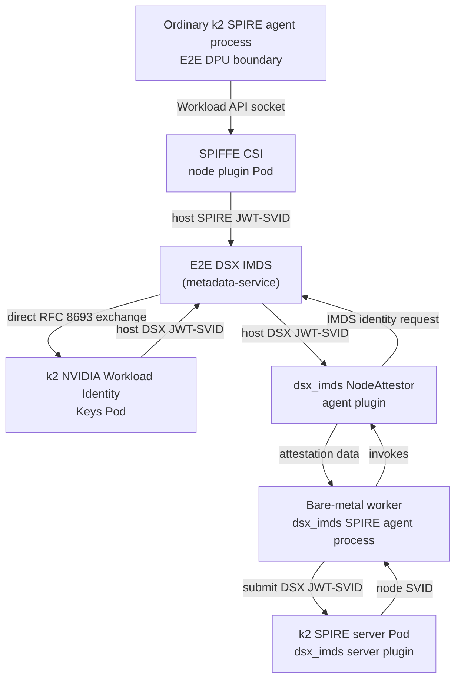
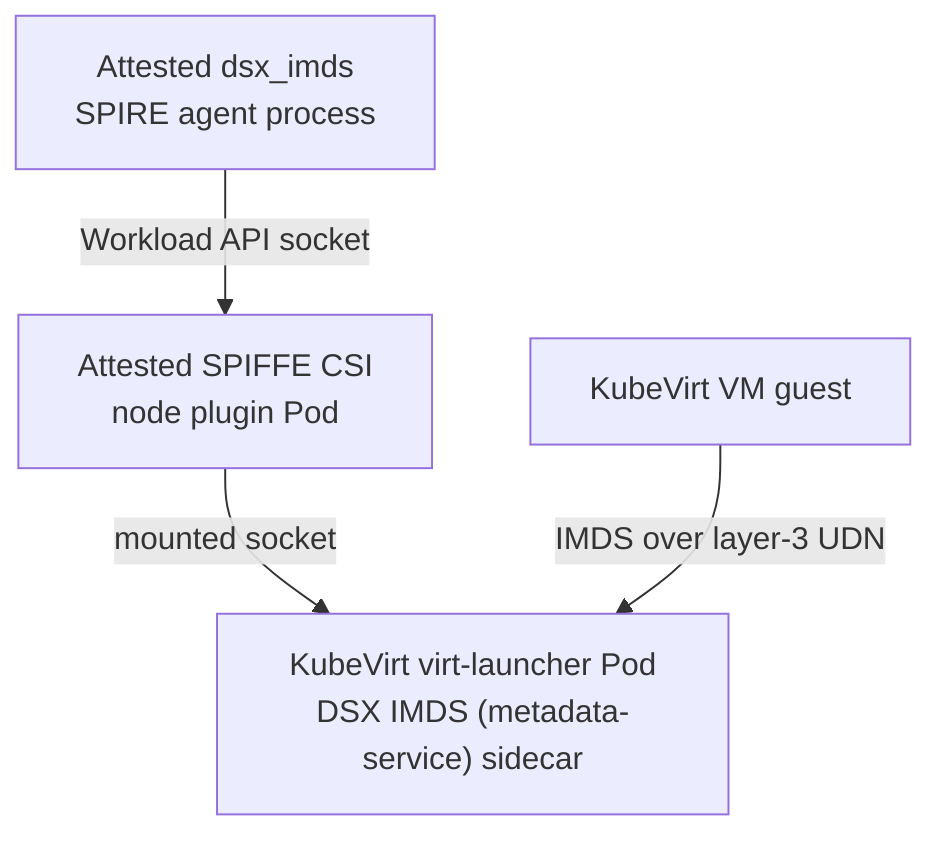
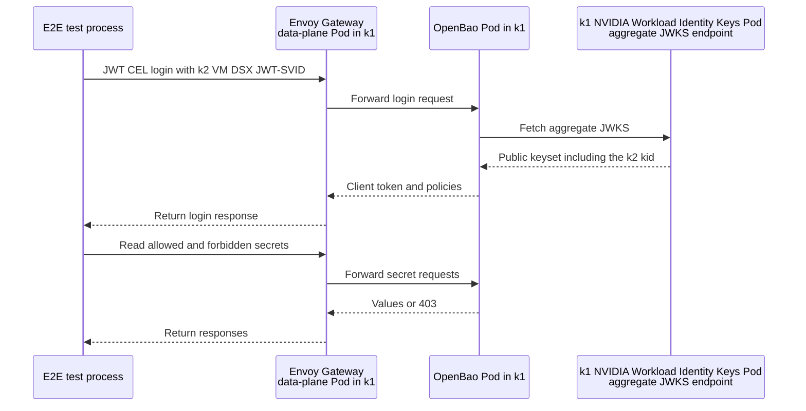

# Local E2E

Run commands from the repository root.

The repository validates the architecture with two Kind clusters. k1 hosts a
Common Services identity shard, one unauthenticated NATS server with in-memory
JetStream for KV, and the
OpenBao relying party. k2 hosts a Data Hall identity shard, the Identity
Controller, OVN-Kubernetes layer-3 UDN, and KubeVirt VMs using `bridge` and
`l2bridge` bindings. The k1 and k2 names
describe only this fixture and do not define a trust hierarchy. Local identity
components use one replica and SPIRE uses its SQLite default.

Local fixtures configure NVIDIA Workload Identity Keys HTTP endpoints
directly. The local Zot registry caches image pulls for both Kind clusters and
local builds through `mirror.gcr.io`. Set `KIND_DOCKERHUB_MIRROR` to an HTTPS
registry origin to route Docker Hub pulls from Kind directly through that mirror.
If the mirror is unavailable, the pull fails. Leave it unset to use Zot.
Zot stores each upstream under its registry hostname so pulls select the
matching source. CI uses the NVIDIA mirror for Kind and as Zot's preferred
Docker Hub mirror, with Docker Hub as Zot's fallback. CI preserves runtime
image caches across these registries within a 10 GB budget. The Go toolchain
image is excluded to leave room for the runtime images. Cache keys track the
pinned image inputs.

The identity chart is installed independently in both clusters. The remaining
components are separate Skaffold modules. Shared fixture settings and the
shard-specific overrides are in:

- `local-e2e-tests/identity-e2e-values.yaml`
- `local-e2e-tests/k1-values.yaml`
- `local-e2e-tests/k2-values.yaml`

## E2E-only `dsx_imds` bootstrap

Kind starts without an external DPU or an attested worker agent. Before the
worker agent is available, the control-plane node represents the Phase 0 seed
host. Each identity chart is installed once. Its normal NVIDIA Workload
Identity Keys Pod runs on the seed node and uses the ordinary operator-Pod
registration there while the worker's `dsx_imds` agent attests. NVIDIA
Workload Identity Keys has no bootstrap-specific identity or deployment path.

Both local shards must exercise host attestation without physical DPU hardware.
Each therefore runs an official SPIRE agent DaemonSet constrained to its worker
as the external host-agent fixture. The ordinary shard agent remains on the
control-plane node as the emulated external DPU boundary. One SPIFFE CSI driver
exposes each node's canonical Workload API socket. The worker agent's
`dsx_imds` plugin obtains a DSX JWT-SVID from DSX IMDS and submits it to the
repository-owned `dsx_imds` server plugin for node attestation. k2 then reuses
that worker agent for its KubeVirt VM path.

The local fixture exposes the real DSX IMDS implementation directly at the
external intercept and passthrough boundary. E2E sends the IMDS request,
exchanges the selected SPIRE JWT-SVID, and uses the returned DSX JWT-SVID for
`dsx_imds` node attestation. It does not test physical link-local routing or
NICo integration.

The ordinary-agent entry is the permitted fixture at the external `dpu_hw`
boundary. E2E requests the operator-host identity from IMDS and attests the
worker's `dsx_imds` SPIRE agent with it. The fixture derives the operator host
ID from the worker name without creating a controller input for that worker.

This external-agent fixture uses the shared
`local-e2e-tests/dsx-imds-host-agent-values.yaml` values and a shard override under
`local-e2e-tests/k1` or `local-e2e-tests/k2`. It is not part of the identity chart release.





The KubeVirt VM contains no SPIRE agent. SPIFFE CSI exposes the attested second
agent's Workload API socket to the virt-launcher Pod, and DSX IMDS uses that
socket to fetch the VM SPIRE JWT-SVID.

## DPU SPIFFE CSI fixture

DPF provides `csi.spiffe.io` in DPU clusters. Local E2E installs the published
SPIRE chart with only SPIFFE CSI enabled on `k2-worker`. The fixture uses
`dpu.csi.spiffe.io` to keep its mounts separate from the shard CSI driver. It
exposes the worker host agent socket to the DSX IMDS fixture. Settings live in
[`k2/spiffe-csi-values.yaml`](k2/spiffe-csi-values.yaml), and the chart release
is pinned in [`skaffold/k2.yaml`](../skaffold/k2.yaml).

## VM network bindings

Each network mode runs both VM bindings with real DSX IMDS sidecars. The binding
name describes the guest's Ethernet attachment, not the UDN topology.
Both guests use the [KubeVirt Alpine image with test tooling](k2/vm/vm.yaml).
Each guest has one vCPU and 160 MiB of RAM, a virtual RNG, and no graphics
device. The memory request is 160 MiB and the limit is 212 MiB before KubeVirt
adds runtime overhead. These fixtures reserve 20 MiB of extra QEMU headroom,
following the [upstream overhead estimate increase](https://github.com/kubevirt/kubevirt/pull/18388).

| Namespace | Primary UDN | Identity suffix | IMDS endpoints |
| --- | --- | --- | --- |
| `tenant-tenant1` | Dual stack | None | `169.254.169.254` and `fd00:76b9::254` |
| `tenant-tenant1-ipv4` | IPv4 only | `-ipv4` | `169.254.169.254` |
| `tenant-tenant1-ipv6` | IPv6 only | `-ipv6` | `fd00:76b9::254` |

The single-stack Kustomize overlays reuse the VM resources and SSH credentials.
Each namespace has its own UDN, external client, and VM identity subjects.
The Launch Layer status publisher runs in the dual-stack namespace to reach
the IPv4 Kubernetes API service. Namespace Roles let it publish all six
virt-launcher Pod UIDs to their VirtualInstance status.

| VM | Binding | Guest network configuration |
| --- | --- | --- |
| `e2e-debian-vm` | Built-in `bridge` | Cloud-init uses KubeVirt DHCP for allocated IPv4 and configures allocated IPv6 |
| `e2e-debian-vm-l2bridge` | `l2bridge` with `managedTap` | Cloud-init hook supplies the CNI-assigned addresses, MAC match, and gateways |

Both bindings rename the CNI interface and attach it to a `k6t-*` bridge with
the VM tap. A dummy takes the original interface name and retains the Pod
address configuration. IMDS setup reads the primary OVN pod-networks entry
through the Downward API, so it works even when the dummy has no guest IPv4.
It installs the guest reply route and a permanent neighbor through the IMDS
veth path. Both fixtures retain the OVN allocation MAC required by the sidecar.

Both fixtures use KubeVirt's upstream cloud-init hook. An E2E-only admission
policy projects the Pod's OVN allocation into that hook. The hook configures
allocated IPv6 addresses for `bridge` and all allocated addresses for `l2bridge`,
which supplies no DHCP server. The l2bridge fixture registers `managedTap` in KubeVirt.

For each binding and network mode, the external client SSHes to the CNI-assigned
guest address, requests a VM identity from each applicable IMDS endpoint, and
authenticates each returned token through OpenBao. The checks verify the VM
subject, signature, and allowed and forbidden secret access. See the [network
setup README](../cmd/dsx-imds-network-setup/README.md) for the packet path.

After the initial identity checks, the suite abruptly restarts the shared worker
identity keys proxy and requests identity from every existing VM again. This
checks recovery of each mounted socket across both bindings and all three
network modes.

## Cross-shard OpenBao validation

The local E2E topology deploys OpenBao in k1 as an external relying party. A
VM DSX JWT-SVID issued in k2 is accepted because the k2 NVIDIA Workload Identity
Keys public key propagates through the Event Bus and appears in the k1 NVIDIA
Workload Identity Keys aggregate JWKS.



## Workflow

Repository validation requires Git, mise, Make, `curl`, and a supported Linux
host. `make validate` builds Linux-only nftables code and exercises Unix socket
paths that exceed macOS limits. macOS and WSL are unsupported. Mise installs the
repository-pinned tools. The full E2E lifecycle also requires Docker with
Buildx, OpenSSL, OpenSSH, and the kernel features needed by OVN-Kubernetes and
KubeVirt, including the `vrf` module for primary UDN gateways and IPv6-enabled
Docker networking for the dual-stack k2 cluster. Missing prerequisites fail the
job rather than skipping tests. CI installs Ubuntu's extra module package for
the running kernel before loading these modules.

The registry setup creates the shared `kind` Docker network with IPv6 enabled.
An existing IPv4-only `kind` network must be recreated with IPv6 before running
this fixture. Stop its clusters and attached containers before recreating it.

```bash
git submodule update --init --recursive
make validate
```

The DPF submodule supplies the `dpu-hw-server` source embedded by
`Dockerfile.spire`. Keep the submodule initialized when building the SPIRE
server image.

One root Skaffold workflow deploys both Kind clusters.

```bash
make -j install
make test
make clean
```

The bridge VM requests an identity without a role. The l2bridge VM supplies
`launchlayer.nvidia.com/role: trainer`. Both paths verify the signed subject and
resource claims through IMDS and the OpenBao relying party.

The E2E suite verifies operator-host IMDS through both `dsx_imds` plugin halves,
DPU file delivery, Pod and VM identity delivery through both bindings, shard isolation, NATS KV
propagation, aggregate JWKS behavior, OpenBao authorization, restart recovery,
and signing-key rotation. External DPU and standalone-host hardware is not
modeled as Kubernetes Nodes.
